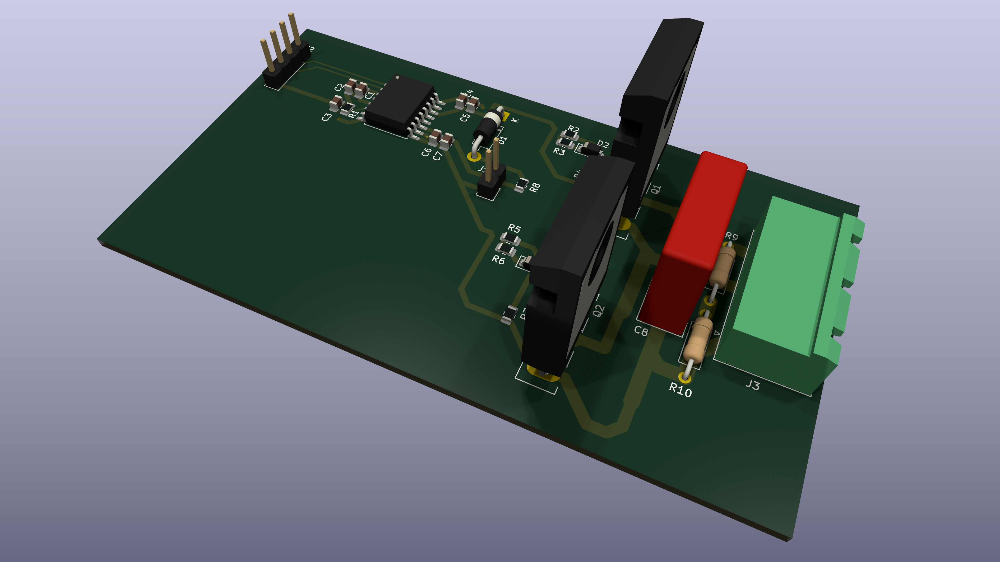
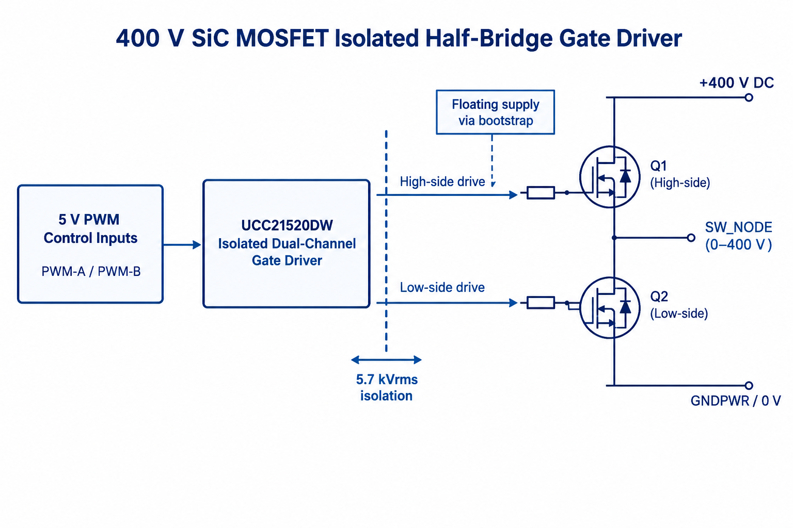
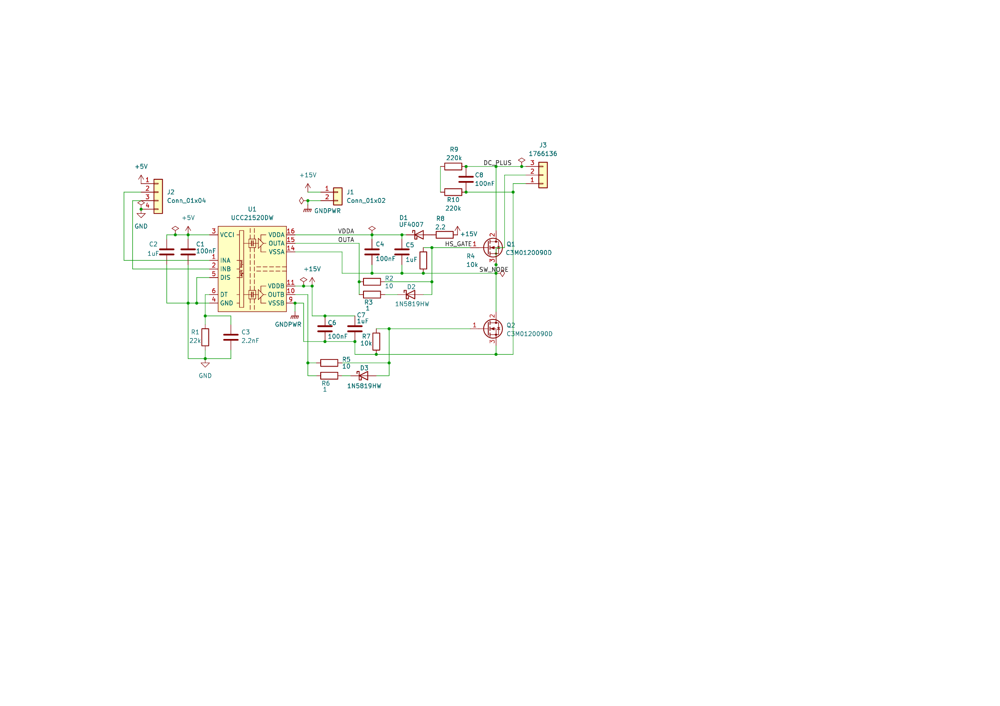
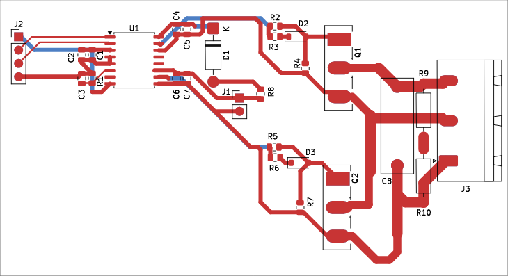
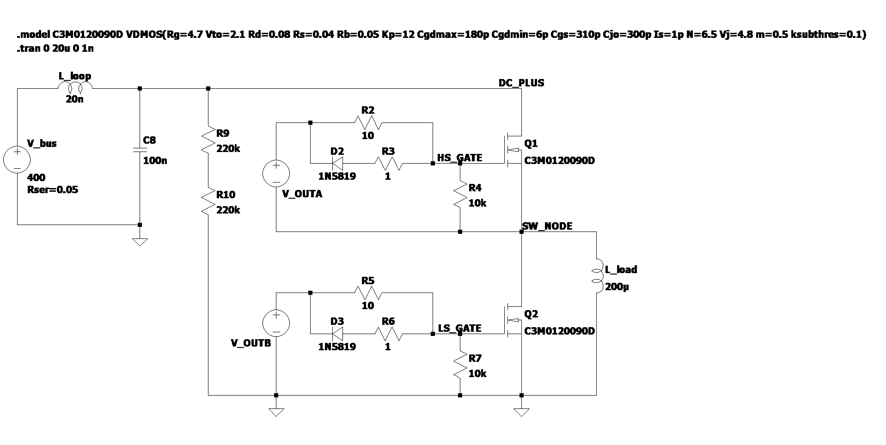
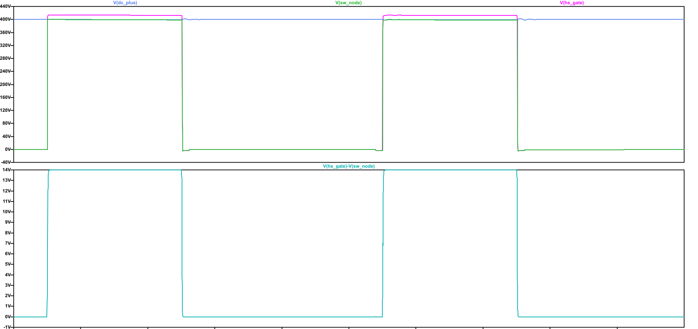

# 400 V SiC MOSFET Isolated Half-Bridge Gate Driver PCB

## Overview

**Objective:** To design a two-layer PCB for an isolated 400 V SiC MOSFET half-bridge gate driver using the UCC21520DW, with appropriate isolation, gate-drive control, and dead time. The design will be checked in KiCad and its switching behaviour verified through LTspice simulation.

This project covers the design and simulation of a 400 V isolated half-bridge gate driver using KiCad 10.0 and LTspice 26.1. A Texas Instruments UCC21520DW isolated dual-channel gate driver controls two Wolfspeed C3M0120090D 900 V SiC MOSFETs.

📄 **[Read the Full Technical Report (PDF)](Documentation/Technical%20Report%20-%20400V%20SiC%20MOSFET%20Isolated%20Half-Bridge%20Gate%20Driver%20PCB.pdf)**

---

## System Block Diagram

The 5 V PWM inputs (PWM-A and PWM-B) are separated from the 400 V power stage by the 5.7 kVrms isolation barrier inside the UCC21520DW. On the secondary side, the driver switches Q1 and Q2 across the 400 V DC rail and GNDPWR to swing SW_NODE between 0 V and 400 V, using a bootstrap network to power the floating high-side drive.

---

## Key Specifications

- DC bus voltage: 400 V DC
- Power switches: 2 × Wolfspeed C3M0120090D 900 V SiC MOSFETs in TO-247-3 packages
- Gate driver: Texas Instruments UCC21520DW, with a stated isolation rating of 5.7 kVrms
- Gate-drive supply: +15 V, with a bootstrap network for the floating high-side supply
- Hardware dead time: Approximately 220 ns, set using R1 = 22 kΩ
- PCB: Two copper layers
- High-voltage clearance rule: Custom KiCad design rule set to 2.9 mm for DC_PLUS and SW_NODE against other nets, with an exception for connections within the same floating high-side section

---

## Hardware Design and PCB Layout

### 1. Schematic

The UCC21520DW isolates the logic ground (GND) from the power-side connections (GNDPWR and SW_NODE). The low-side MOSFET is referenced to ground, while the high-side driver floats with SW_NODE.

When the low-side MOSFET turns on and SW_NODE falls to 0 V, the +15 V rail charges bootstrap capacitors C4 and C5 through resistor R8 and diode D1. When the high-side switch turns on, D1 becomes reverse-biased and the capacitors supply the floating driver at about 14 V (accounting for a 1 V diode drop).

The gate resistors use separate paths for turn-on and turn-off. The 10 Ω resistors (R2 and R5) control gate charging, while the Schottky diodes (D2 and D3) and 1 Ω resistors (R3 and R6) provide a lower-resistance turn-off path (~0.91 Ω in parallel) to discharge the gate quickly. The 10 kΩ pull-down resistors (R4 and R7) keep the gates near 0 V when unpowered.

Resistor R1 (22 kΩ) sets the dead time to about 220 ns, with capacitor C3 placed in parallel to filter noise. Capacitor C8 (100 nF, 630 V) is placed near the MOSFETs to absorb switching transients, and two 220 kΩ resistors (R9 and R10) are placed in series as bleeders so each sees 200 V.

### 2. Two-Layer PCB Layout

The logic section is placed on the left and the power stage on the right. No traces are routed beneath U1, leaving more than 8 mm of separation between the logic and high-voltage sides. The layout was checked in KiCad against the 2.9 mm high-voltage clearance rule until no DRC errors remained.

Because the MOSFET pins have a 5.45 mm centre-to-centre spacing, the DC_PLUS, SW_NODE, and GNDPWR traces narrow to 1.5 mm near the pads before widening to 2.0 mm. SW_NODE is routed on the top layer between C8 and the R9/R10 midpoint without extra vias. C8, R9/R10, and J3 are kept near Q1 and Q2 to shorten the switching path and reduce parasitic inductance.

---

## LTspice Simulation

The secondary-side half-bridge was simulated in LTspice over 20 µs (two switching periods at 100 kHz). To avoid convergence problems, the UCC21520DW and bootstrap circuit were replaced with pulse voltage sources (0–14 V referenced to SW_NODE for the high side, and 15–0 V referenced to ground for the low side, with 15 ns rise/fall times and 220 ns dead time).

The model uses a 400 V supply (0.05 Ω series resistance), a 20 nH supply-loop inductance, a 200 µH inductive load (20 Ω series resistance), and a custom VDMOS model for the C3M0120090D.

### Results

| Objective | Achieved result |
|:---|:---|
| 1. Design a PCB for a 400 V half-bridge | A two-layer KiCad PCB was designed for two 900 V SiC MOSFETs. |
| 2. Separate the control and power sections | The layout keeps copper out from beneath the gate driver and maintains more than 8 mm of spacing between the logic and high-voltage sides. |
| 3. Set suitable dead time to prevent shoot-through | A 22 kΩ resistor sets approximately 220 ns dead time. No shoot-through was observed in the LTspice simulation. |
| 4. Provide suitable gate drive for both MOSFETs | The simulation showed approximately 14 V gate-to-source drive for the high-side MOSFET and 15 V for the low-side MOSFET. |
| 5. Check switching behaviour at 400 V | The simulated switching node transitions between approximately 0 V and 400 V over two 100 kHz periods. |
| 6. Check for unwanted turn-on caused by the Miller effect | Simulated low-side gate bounce was approximately 0.7–0.8 V, below the 1.8 V threshold used in the report for comparison. |

The simulation results confirm that the intended timing, drive voltages, and isolation are achieved under ideal models, although hardware testing will be required to evaluate physical ringing and thermal performance on a fabricated PCB.

---

## Bill of Materials (BOM)

| Ref. | Qty. | Value / Role | Footprint | Manufacturer | Part Number (MPN) |
|:---|:---:|:---|:---|:---|:---|
| U1 | 1 | Isolated gate driver | SOIC-16W | Texas Instruments | UCC21520DW |
| Q1, Q2 | 2 | 900 V SiC MOSFET | TO-247-3 | Wolfspeed | C3M0120090D |
| D1 | 1 | Bootstrap diode | DO-41 axial | Generic | UF4007 |
| D2, D3 | 2 | Gate turn-off diode | SOD-123 SMD | Generic | 1N5819HW |
| C8 | 1 | 100 nF snubber capacitor, 630 V | Radial, 15 mm pitch | WIMA | MKP1J031004B00KSSD |
| R9, R10 | 2 | 220 kΩ bleeder resistor | 0207 axial | Yageo | MFR-25FTE52-220K |
| R1 | 1 | 22 kΩ dead-time resistor | 0805 SMD | Yageo | RC0805FR-0722KL |
| R2, R5 | 2 | 10 Ω turn-on resistor | 0805 SMD | Yageo | RC0805FR-0710RL |
| R3, R6 | 2 | 1 Ω turn-off resistor | 0805 SMD | Yageo | RC0805FR-071RL |
| R4, R7 | 2 | 10 kΩ gate pull-down resistor | 0805 SMD | Yageo | RC0805FR-0710KL |
| R8 | 1 | 2.2 Ω bootstrap charging resistor | 0805 SMD | Yageo | RC0805FR-072R2L |
| C1, C4, C6 | 3 | 100 nF decoupling capacitor | 0805 SMD | Murata | GRM21BR71H104KA01L |
| C2, C5, C7 | 3 | 1 µF supply capacitor | 0805 SMD | Murata | GRM21BR71H105KA12L |
| C3 | 1 | 2.2 nF dead-time filter capacitor | 0805 SMD | Murata | GRM21BR71H222KA01L |
| J3 | 1 | High-voltage terminal header, 1×03, 7.62 mm pitch | GMSTBA 1×03 | Phoenix Contact | 1766246 |
| J1, J2 | 2 | Low-voltage headers, 1×02 and 1×04 | 2.54 mm pitch | Generic | 1×02 and 1×04 male headers |

---

## Design Limitations and Possible Improvements

1. Shorter trace paths: The current board uses wide spacing for straightforward routing, making some connections between U1, the MOSFETs, and C8 longer than ideal. Moving components closer and using copper pours would reduce stray inductance and ringing.
2. Bipolar gate supply (-4 V / +15 V): The 1 V drop across D1 lowers the high-side gate drive to ~14 V, and real hardware could experience higher gate bounce than the simulated 0.8 V. Replacing the bootstrap circuit with an isolated bipolar supply (-4 V / +15 V) would address both issues.
3. Shorter dead time: Reducing R1 from 22 kΩ to 10 kΩ would shorten dead time from 220 ns to ~100 ns, reducing body-diode conduction losses once hardware testing confirms no shoot-through.
